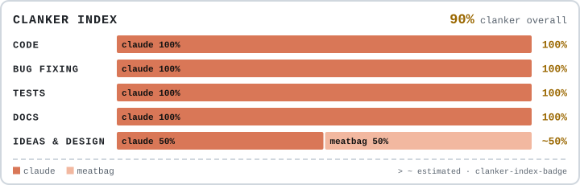
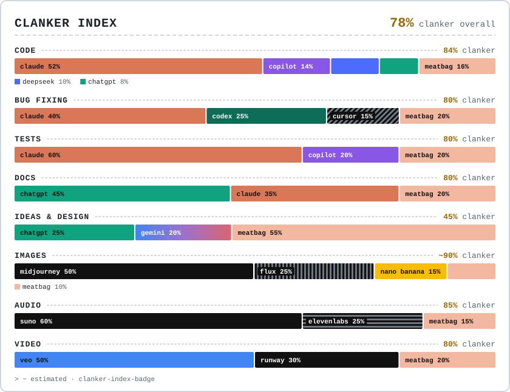
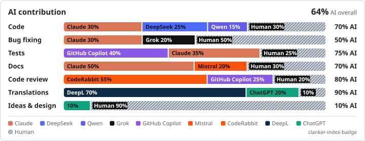

# Clanker Index Badge

A README badge that shows **how much of your project was made by which AI**, split into code, bug fixing, tests, docs, ideas, images, audio, video and more.

<picture>
  <source media="(prefers-color-scheme: dark)" srcset=".clanker/clanker-dark.svg">
  
</picture>

*↑ This repo's own badge, rebuilt on every push.*

Every badge comes in two styles, each in light and dark mode:

| Clanker (fun) | Serious |
|---|---|
| <picture><source media="(prefers-color-scheme: dark)" srcset="examples/game/clanker-dark.svg"></picture> | <picture><source media="(prefers-color-scheme: dark)" srcset="examples/backend/serious-dark.svg"></picture> |

More samples in [`examples/`](examples/): a game, a backend, a music app, and a repo with 20 different AIs.

## Quick start

**1. Add the workflow** as `.github/workflows/clanker-index.yml`:

```yaml
name: Clanker Index
on:
  push:
    branches: [main]
  workflow_dispatch:
permissions:
  contents: write
jobs:
  badge:
    runs-on: ubuntu-latest
    steps:
      - uses: actions/checkout@v4
        with:
          fetch-depth: 0   # full history, needed to see who wrote what
      - uses: LuminoOwO/clanker-index-badge@v1
```

**2. Push.** The action writes the badges to `.clanker/` and commits them.

**3. Paste this into your README:**

```html
<picture>
  <source media="(prefers-color-scheme: dark)" srcset=".clanker/clanker-dark.svg">
  
</picture>
```

Prefer the serious look? Replace `clanker-` with `serious-` in both lines.

That's it. Without a config file you get code, bug fixing, tests and docs, measured from git. To add images, audio, ideas and so on, add a `.clanker.yml` (next section), or run `npx github:LuminoOwO/clanker-index-badge init` to set everything up in one go.

## `.clanker.yml`

The only file you ever edit:

```yaml
style: clanker            # clanker | serious (which one the README snippet uses)

categories:
  code: auto              # measured from git
  bugfix: auto
  tests: auto
  docs: auto
  ideas:  { human: 70, chatgpt: 30 }               # git can't see these,
  images: { midjourney: 50, flux: 25, estimated: true }   # so you fill them in
  audio:  { suno: 100 }
  video:  off
```

It's hard to break on purpose:

- **Write AI names, never colors.** `Claude`, `github copilot`, `DALL-E`, `nano banana`: case, spaces and common aliases all work. Colors come from the built-in palette.
- **Typos get a suggestion**: `unknown AI "midjurney". Did you mean "midjourney"?` The action fails with that message instead of publishing a broken badge.
- **Shares don't have to add up to 100.** `audio: { suno: 60 }` means 60% Suno and 40% human. Totals over 100 are scaled down.
- **Sorting is automatic**: biggest AI first, human always last, tiny AIs (under `min_share`) grouped as "other".
- **Empty categories disappear** on their own.
- `estimated: true` adds a `~` to that category's number.

<details>
<summary>All settings</summary>

| Setting | Default | What it does |
|---|---|---|
| `style` | `clanker` | Design used in the README snippet. All four SVGs are generated either way. |
| `title` | Clanker Index / AI contribution by category | Badge heading. |
| `categories` | code, bugfix, tests, docs on `auto` | Per category: `auto`, `off`, or shares like `{ claude: 60, human: 40 }`. |
| `overall` | `average` | The big number: `average` of the categories, `none`, or one category such as `code`. |
| `min_share` | `2` | AIs below this percentage are grouped as "other" (when there are at least two of them). |
| `merge` | none | Count one AI as another, e.g. `{ cursor: claude }` if you ran Claude inside Cursor. |
| `paths.ignore` / `paths.tests` / `paths.docs` | sensible defaults | Extra globs for which files are ignored or count as tests or docs. |

Categories: `code`, `bugfix`, `tests`, `docs`, `review` (code review), `translations`, `ideas` (ideas & design), `images`, `audio`, `video`. Only `review`, `translations` and `ideas` can't be `auto`.

</details>

## How it measures

Guessing authorship by reading the code doesn't work, and AI "detectors" are unreliable. So the badge only counts what it can prove, and you fill in the rest.

| Category | Source |
|---|---|
| Code, tests, docs | `git blame`: every line that still exists is credited to the commit that wrote it. If you rewrite an AI's code, it becomes yours. |
| Bug fixing | Lines changed in fix commits (`fix: …` subjects or a `Clanker-Category: bugfix` trailer). |
| Images, audio, video | Files credited to the commit that added them, or (usually better) shares you write in `.clanker.yml`. |
| Ideas, review, translations | Shares you write in `.clanker.yml`. |

A commit counts as AI-made when it has one of these, checked in this order:

1. A `Clanker-Model: claude` trailer.
2. A `Co-Authored-By:` trailer from a known AI. Claude Code, Aider and others add these already.
3. An AI author or committer, such as Copilot's or Devin's bot accounts.

Bot commits from Dependabot, Renovate, GitHub Actions and similar are skipped.

### Tell your AI agents to sign their work

`init` adds this section to your `AGENTS.md`, the instructions file most coding agents read:

```
Co-Authored-By: <product name> <noreply@vendor.com>
Clanker-Model: <claude | codex | copilot | cursor | gemini | …>
Clanker-Category: bugfix        (only on bug fixes)
```

The markers go in **commit messages, never in the code**. That way they don't clutter files, don't go stale when someone edits a line, and don't cause merge conflicts.

## Known AIs

**Models**: claude, chatgpt, codex, gemini, gemma, grok, llama, deepseek, qwen, mistral, kimi, glm, minimax, command (Cohere), phi, nova, sonar (Perplexity), granite, nemotron, ernie
**Agents and tools**: copilot, cursor, windsurf, devin, v0, aider, cline, replit, lovable, bolt, jetbrains, kiro, coderabbit, deepl
**Images**: midjourney, gpt-image (DALL-E), nano-banana (Imagen), flux, stable-diffusion, firefly, ideogram
**Video**: sora, veo, runway, kling, pika, dream-machine (Luma), hailuo, seedance
**Audio**: suno, udio, elevenlabs, stable-audio, lyria, musicgen
**Special**: `human`, and `other` for anything not listed

Run `npx github:LuminoOwO/clanker-index-badge models` for every accepted spelling. Black-and-white brands (Grok, Cursor, Midjourney, …) get solid black/white or a pattern, so they stay distinct.

Missing an AI, or a color that's off? Everything lives in [`src/palette.js`](src/palette.js), one line per AI. PRs welcome.

## Run it locally

```sh
npx github:LuminoOwO/clanker-index-badge check      # print the numbers, write nothing
npx github:LuminoOwO/clanker-index-badge            # write .clanker/*.svg
npx github:LuminoOwO/clanker-index-badge init       # add config, workflow and AGENTS.md section
```

Requires Node 20+ and git. Outputs: `clanker-dark.svg`, `clanker-light.svg`, `serious-dark.svg`, `serious-light.svg` and `data.json` (the raw numbers).

## Contributing

```sh
npm ci
npm test
npm run build      # the action runs dist/, so commit it too
npm run examples   # re-render examples/
```

---

AI names and colors are used only to identify each product. All trademarks belong to their owners; this project isn't affiliated with any of them. MIT licensed.
